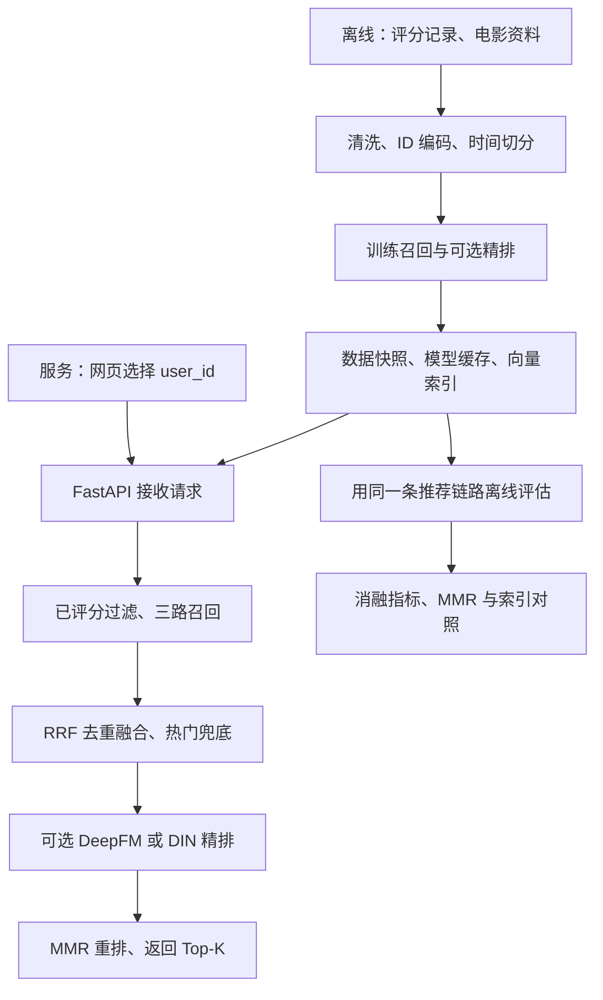

# MovieLens 推荐系统项目说明

这个项目解决的是 **Top-K 电影推荐**。给定 MovieLens 用户 ID，从 9,742 部电影中找出用户可能发生下一次交互的电影，排除数据中已经评过分的电影，返回前 K 部及其推荐理由。

默认链路是 **ItemCF、BPR-MF、双塔三路召回 → RRF 融合 → MMR 重排**。热门榜负责在候选不足时补齐，或者服务没有历史的新用户。DeepFM 和 DIN 已完成训练、接入和效果对照，通过 `rank.model` 可以启用其中一个。当前默认值为 `none`，依据是验证集上的全链路结果。

## 1. 整体架构



| 模块 | 职责 | 代码入口 |
| --- | --- | --- |
| 数据 | 读取评分和电影资料，构造训练、验证、测试数据及已评分集合 | [prepare.py](../src/movielens/data/prepare.py) |
| 推荐编排 | 串联召回、融合、精排和重排，记录各阶段耗时 | [pipeline.py](../src/movielens/pipeline.py) |
| 模型 | 计算相似度、学习隐向量、训练双塔及精排网络 | [recall](../src/movielens/recall) · [mf](../src/movielens/mf) · [rank](../src/movielens/rank) |
| 服务 | 启动时加载数据和模型，提供推荐、健康检查和指标接口 | [FastAPI](../src/movielens/api/main.py) · [演示页](../src/movielens/web/index.html) |
| 评估与发布 | 跑消融实验，导出发布包，在目标机器验证 HTTP 和重启 | [评估脚本](../scripts/evaluate.py) · [打包脚本](../scripts/package_release.py) · [验收脚本](../scripts/smoke_deploy.py) |

每个召回源都返回统一的 `Candidate`，内部用 `user_idx` 和 `item_idx` 访问数组，API 出口再还原为 MovieLens 的原始 ID。这种接口使召回源和精排器可以独立替换，离线评估也能调用服务使用的同一条链路。[候选协议](../src/movielens/schema.py)

## 2. 跟着一次推荐请求读代码

网页选定用户和推荐数量后，会发送类似下面的请求。第一个参数是用户 ID，`k` 决定返回数量，`use_rerank` 控制 MMR 开关，`lam` 控制 MMR 对相关性的侧重。

```bash
curl 'http://127.0.0.1:8000/recommend/1?k=10&use_rerank=true&lam=0.7'
```

1. **定位用户并收集已评分电影。** `recommend()` 把 `user_id` 映射为内部 ID。已有用户使用整个数据快照的已评分集合过滤候选。
2. **生成候选。** `recall()` 调用 ItemCF、BPR-MF 和双塔，每路最多返回 200 部。RRF 按电影 ID 去重后融合名次。缺少个性化候选时，热门榜补充结果。
3. **决定展示顺序。** 默认相关性来自 RRF。启用 DeepFM 或 DIN 后，候选会先按 `rank_score` 排序。开启 MMR 时，再从排序前 50 部里逐个挑选并返回 Top-K。
4. **还原展示字段。** 响应包含电影 ID、片名、类型、融合分、召回来源和推荐理由。使用精排时增加精排分，各阶段耗时随请求返回。

用本地数据和默认模型实跑 `user_id=1` 时，这个用户有 232 条历史评分，三路各返回 200 部，融合后留下 477 部候选。电影 *Peter Pan (1953)* 在融合榜排第 12，开启 MMR 后排第 4。这个例子展示了召回、融合和重排各自负责的部分。[推荐入口](../src/movielens/pipeline.py#L214)

同一份快照、用户、模型和参数通常会产生可复现的结果。改变 MMR 开关或 λ 可以在网页看到不同的列表。用户兴趣画像在数据准备和模型训练时生成，当前演示页提供查询和重排参数。

## 3. 数据和训练目标

默认使用 MovieLens `ml-latest-small`，包含 **610 位用户、9,742 部电影和 100,836 条评分**。项目清洗重复的用户与电影对，把原始 ID 转成连续下标，编码电影类型和年份，再把交互、电影表和负采样中间结果写成 Parquet。ID 映射、已评分集合及评估答案等元数据由 `Dataset` 一并加载。[数据读取与缓存](../src/movielens/data/dataset.py) · [MovieLens 数据说明](https://files.grouplens.org/datasets/movielens/ml-latest-small-README.html)

默认配置 `positive_threshold: 0` 把每条评分记作一次正向交互，包括低星评分。离线主任务是预测用户接下来会与哪部电影发生评分交互。用户平均评分仍可作为精排输入。

默认 **Leave-last-out** 按每个用户自己的时间线切分。最后一条留给测试，倒数第二条留给验证，其余做训练。

| 场景 | 评分条数 | 过滤的已评分电影 |
| --- | ---: | --- |
| 训练 | 99,616 | 依据各模型的训练负采样规则 |
| 验证 | 610 | 只过滤训练历史，保留验证目标 |
| 测试 | 610 | 过滤训练与验证历史，保留测试目标 |
| 网页查询 | — | 过滤当前数据快照里的全部评分历史 |

按用户分别留出时，每个人自己的时间线有效，但共享模型有可能见过发生在其他用户测试时点之后的行为。配置提供 `global` 作为全局时间切分方案。阅读离线指标时，应把切分策略、正例定义和候选过滤规则一起看。[切分和标签](../src/movielens/data/prepare.py#L78) · [默认配置](../configs/default.yaml)

## 4. 四路召回怎么工作

### ItemCF 从共同评分行为找相似电影

ItemCF 先构造用户与电影的稀疏交互矩阵 `R`，用 `R.T @ R` 得到两两电影的共同交互强度。逆用户频率权重 IUF 降低超活跃用户对共现的影响，电影热度归一化抑制热门片天然共现更多的效应。项目为每部电影最多保留 20 个邻居，使相似度表易于存储和查询。

请求时从最近最多 100 条训练交互出发，汇总这些历史电影的邻居贡献。历史距用户最新一条训练交互越远，权重越低。代码也能找出贡献最大的历史电影，作为「这两部电影经常被同一批人评分」的解释。[ItemCF 实现](../src/movielens/recall/itemcf.py)

### BPR-MF 学习用户与电影的隐向量

矩阵分解为每个用户和每部电影学习一个 32 维向量，两者点积用来估计匹配程度。BPR 使用 **pairwise 排序**，每个训练样本由用户、他交互过的电影和一部采样出的未交互电影组成。训练把前一部电影的分数推到后一部之前。项目每轮重新采样，结合 L2 正则，并用验证集 Recall@10 选择模型。

未交互电影充当训练对照项。上线后，模型用训练好的向量做矩阵乘法，从未评分的电影里取 Top-K。[BPR-MF 实现](../src/movielens/mf/bpr.py) · [BPR 原论文](https://arxiv.org/abs/1205.2618)

### 双塔学习可独立编码的用户与电影表示

用户塔接收用户 ID 和最近最多 32 部训练历史电影的向量平均值。电影塔接收电影 ID、类型和上映年份。各自的多层感知机输出 64 维归一化向量，点积等价于余弦相似度。训练样本的历史使用对应正例之前的序列前缀。

损失使用 **InfoNCE**。同一个批次内其他样本的正例可作为对照，还会为每个正例采额外负样本。某个对照项如果已出现在这个用户的训练历史中，代码会把它屏蔽。训练结束后提前导出用户向量和电影向量，请求时直接查用户向量和近邻。

- **FAISS Flat** 做精确内积搜索，Linux 默认使用这个后端。
- **FAISS HNSW** 通过图搜索近邻，项目把它用于索引对照。现有实验中，HNSW 与 Flat 的 Top 10 平均重合约 97.93%，Top 200 候选平均重合约 80.29%。
- **NumPy** 在 macOS 默认执行等价的精确内积搜索，避开本机原生 OpenMP 运行库冲突。

[双塔与采样](../src/movielens/recall/two_tower.py) · [FAISS 索引封装](../src/movielens/faiss_index.py) · [索引对照脚本](../scripts/compare_index.py) · [FAISS 官方文档](https://github.com/facebookresearch/faiss/wiki/Faiss-indexes)

### 热门榜处理冷启动

默认按训练集交互次数排序。用户 ID 在数据快照里查不到时，直接使用热门召回。已有用户的个性化候选少于 50 部时，热门电影补到候选池尾部，并避免重复与已评分的电影。[热门榜](../src/movielens/recall/popular.py) · [兜底逻辑](../src/movielens/pipeline.py#L121)

## 5. 从候选池到最终列表

### RRF 按名次融合

同一部电影在某一路排第 `r` 名，就得到 `该路权重 / (60 + r)` 的贡献，名次从 1 计。默认各路权重为 1。多路都出现的电影会把贡献相加，只在候选池里保留一份。

例如，为用户 1 召回 *Ferris Bueller’s Day Off* 时，ItemCF、BPR 和双塔分别把它排第 40、1、122，融合分为 `1/100 + 1/61 + 1/182 ≈ 0.031888`。融合统一使用名次，各路提供的分数也会保留，供精排使用。[融合实现](../src/movielens/pipeline.py#L91) · [RRF 原论文](https://doi.org/10.1145/1571941.1572114)

### DeepFM 与 DIN 学习候选级精排分

精排训练在训练窗内再取一个全局时间切点。用切点前的数据拟合召回并生成候选，再用切点后的训练评分标记命中。负例从这批候选里抽取，并赋予抽样权重。模型训练使用候选级二分类损失，选模看验证集的全链路 Recall@10 和 NDCG@10。MovieLens 评分充当交互代理标签，广告 CTR 所需的真实曝光与点击需要另外采集。

- **DeepFM** 把用户 ID、电影 ID、电影类型、热度、用户平均评分、RRF 分和各路召回分等特征放在一起。线性项看单个特征，因子分解机（FM）学习两两交叉，多层感知机学习更复杂的组合。
- **DIN** 让候选电影对用户近期历史依次计算注意力权重。面对一部科幻片，模型可以给用户过去的科幻交互更高权重。每部候选都有自己的加权兴趣向量。

[时序候选样本](../src/movielens/rank/samples.py) · [共享精排特征](../src/movielens/rank/features.py) · [训练与选模](../src/movielens/rank/train.py) · [DeepFM 实现](../src/movielens/rank/deepfm.py) · [DIN 实现](../src/movielens/rank/din.py)

### MMR 同时考虑相关性和多样性

MMR 先选相关性最高的一部，再逐步挑剩下的。相关性采用精排分或默认 RRF 分，并在当前候选窗口内归一化。电影之间的相似度来自类型向量的余弦相似度。

```text
选择分 = λ × 相关性 − (1 − λ) × 与已选电影的最大类型相似度
```

默认 λ 为 0.7。把 λ 调小会让类型相似惩罚更有影响。网页显示的是融合分或精排分，因此开启 MMR 后，显示分略低的电影也可能排在靠前的位置。[MMR 实现](../src/movielens/rerank/mmr.py)

## 6. 怎么判断技术是否有效

- **Recall@10** 衡量测试答案是否进入前十。本次每位测试用户只有一个答案，`0.0836` 对应约 610 人中命中 51 人。
- **NDCG@10** 也看命中发生在什么名次，越靠前得分越高。
- **Coverage** 是所有用户推荐列表合起来覆盖了多少部目录电影。**ILD** 衡量单个用户列表内电影类型的差异程度。二者分别反映全局覆盖和单列表多样性。

以下数据来自 `ml-latest-small` 的 Leave-last-out 消融实验。带 MMR 的方案使用 λ=0.7。

| 方案 | 验证 Recall@10 | 测试 Recall@10 | 测试 NDCG@10 |
| --- | ---: | ---: | ---: |
| 热门榜 | 0.0393 | 0.0377 | 0.0189 |
| ItemCF + BPR-MF + MMR | 0.0754 | 0.0820 | 0.0401 |
| **默认三路召回 + MMR** | **0.1033** | **0.0836** | **0.0414** |
| 三路召回 + DeepFM + MMR | 0.0820 | 0.0475 | 0.0218 |
| 三路召回 + DIN + MMR | 0.0590 | 0.0377 | 0.0192 |

从两路扩展到三路后，测试答案进入全候选池的人数从 **342 增至 392**，进入融合前 50 的人数从 **155 增至 178**，进最终前 10 的人数从 **50 增至 51**。这组数据能区分「召回能否找到答案」和「排序能否把答案送进展示列表」。两种精排器在验证集表现低于原方案，因此默认保留 RRF + MMR。

以上结论对应当前数据集和离线任务。真实点击率、观看时长和商业转化需要各自的行为数据与线上实验。[离线指标实现](../src/movielens/eval/metrics.py) · [复现实验](../scripts/evaluate.py)

## 7. 对应的搜广推技术

| 方向 | 项目实现 | 对应的业务问题 |
| --- | --- | --- |
| 推荐 | ItemCF、BPR-MF、双塔、热门兜底 | 从历史行为和电影特征召回个性化候选，为无历史用户提供可用结果 |
| 搜索 | FAISS 向量检索、RRF 排名融合、NDCG | 找到相似候选、融合不同检索信号、衡量结果顺序。在语义搜索中可以用文本查询向量替换这里的用户向量 |
| 广告 | DeepFM 特征交叉、DIN 行为注意力、候选级训练样本 | 给候选逐条估计用户响应。DeepFM 和 DIN 原论文使用点击率预估，本项目用评分交互作为学习目标 |
| 列表策略 | MMR 多样性重排、热门兜底 | 在最终展示位上兼顾相关性与内容差异 |
| 效果验证 | 时间切分、已评分过滤、验证集选模、消融、索引对照 | 衡量每个阶段对结果质量和检索开销的贡献 |
| 服务工程 | FastAPI、缓存与索引加载、锁定运行依赖、HTTP 及重启检查 | 将离线训练产物变成可以独立运行和验证的服务 |

因此，这个仓库的主体是一个多阶段推荐系统，兼有搜索中的向量检索和融合方法，以及广告中常见的精排模型。它的运行范围是**固定 MovieLens 数据快照上的推荐与实验对照**。完整的关键词搜索、广告竞价、曝光日志与在线反馈属于可扩展范围。[DeepFM 论文](https://arxiv.org/abs/1703.04247) · [DIN 论文](https://arxiv.org/abs/1706.06978) · [多阶段推荐参考](https://research.google/pubs/deep-neural-networks-for-youtube-recommendations/)

## 8. 本地阅读与复现顺序

1. 先按 [README 快速开始](../README.md#快速开始) 准备数据和模型，启动网页。固定用户 ID，来回切换 MMR，观察电影顺序和候选来源。
2. 读 [推荐入口](../src/movielens/pipeline.py#L214)，沿 `recommend()` → `recommend_raw()` → `recall()` → `_rrf()` 看一遍调用过程。
3. 回到 [默认配置](../configs/default.yaml)，找到候选数、索引类型、精排选择和 MMR λ，再读想了解的模型。
4. 用 `.venv/bin/python scripts/train_rank.py` 生成精排缓存，然后运行 `.venv/bin/python scripts/evaluate.py --rank` 复现含精排的 17 组对照。原始数据、模型、索引和指标由脚本生成。
5. 要在另一台机器启动，按 [部署演练](../README.md#部署演练) 生成目标平台的依赖锁，打包数据和模型，再跑 HTTP 验收脚本。
